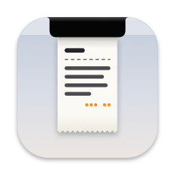
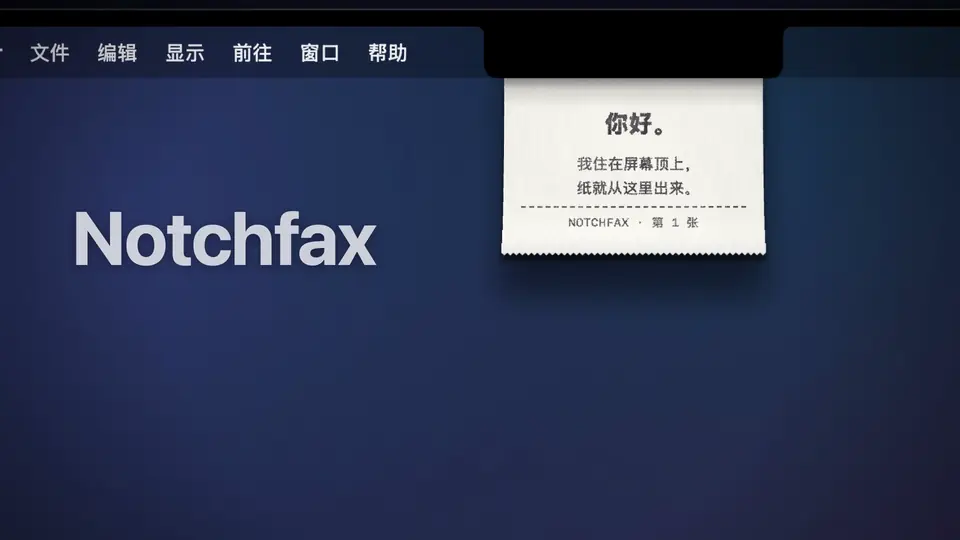
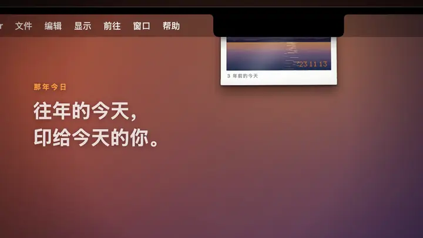
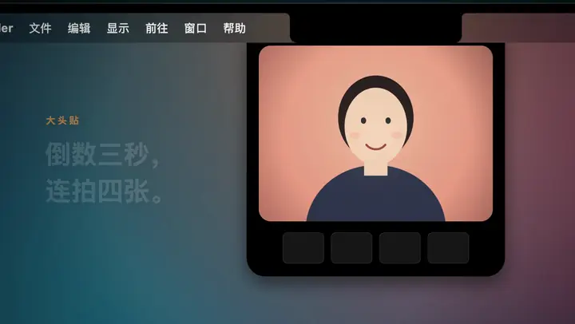
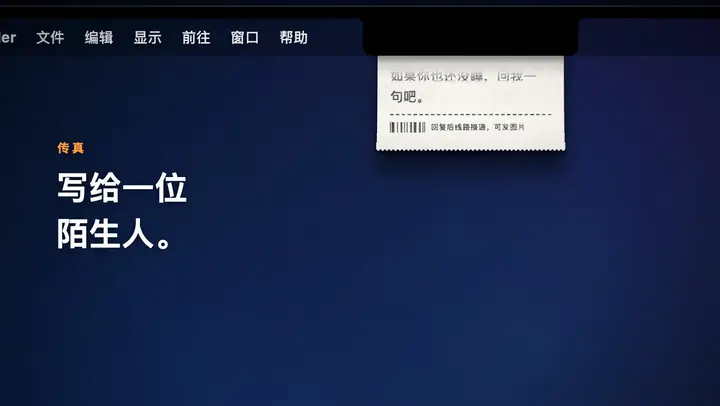
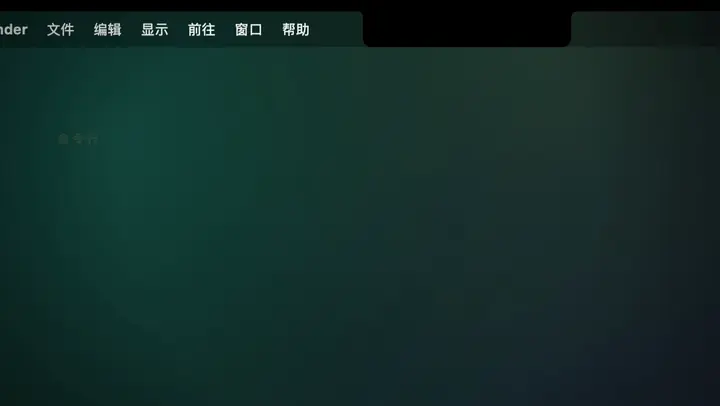

<div align="center">



# Notchfax

**A tiny printer that lives in your MacBook's notch**

Paper feeds out of the top of your screen, right below the notch. Grab it and swing it, tear it off sideways, or drag it out to save it as an image.

[](https://github.com/kadaliao/notchfax/releases/latest)
[](https://github.com/kadaliao/notchfax/actions/workflows/ci.yml)


[](LICENSE)

[中文](README.md) · English



</div>

> The app's interface and printouts are in Simplified Chinese. This page is a translation of the [Chinese README](README.md), which is the one kept most up to date.

## Contents

- [What it does](#what-it-does)
- [Install](#install)
- [Command line](#command-line)
- [AI session receipts](#ai-session-receipts)
- [Fax and privacy](#fax-and-privacy)
- [Build from source](#build-from-source)
- [Project status](#project-status)
- [Contributing](#contributing)

## What it does

Notchfax lives in the menu bar; everything is in its little paper-slip icon.

### On this day



Every day it finds photos taken on this date in earlier years in your Photos library and prints one on glossy photo paper, with an orange dot-matrix date stamp and "N years ago today" on the border. Photos are read on your Mac only and never uploaded.

### Photo booth



A viewfinder drops down below the slot, counts down three seconds and takes four shots, printed as a strip. Ten looks (cartoon, comic, sketch, pop, dreamy, instant, warm, cool, black and white, colour), switched with the arrow keys. Shortcut <kbd>⌃</kbd><kbd>⌥</kbd><kbd>⌘</kbd><kbd>B</kbd>.

### Fax



Write an anonymous fax to a random stranger. The first one can only be text; once they reply, the line connects and you can send pictures too, always converted to black-and-white dots. No accounts, no names.

### Command line and AI session receipts



Print from the terminal with `notchfax print`, or have your coding agent print a cost receipt every time a session ends.

On screens without a notch, Notchfax draws a slot at the top centre. With Reduce Motion turned on, paper fades in and out instead of feeding.

## Install

```sh
brew install --cask kadaliao/tap/notchfax
```

Or download the dmg from [Releases](https://github.com/kadaliao/notchfax/releases/latest) and drag Notchfax into Applications.

- Requires macOS 14 or later. Universal (Apple Silicon and Intel), signed and notarized by Apple.
- On first launch it asks for Photos and Camera access (for On this day and Photo booth), then prints a welcome slip.
- There is no auto-update. Upgrade with `brew upgrade --cask notchfax`, or download again.

## Command line

The Homebrew cask installs the `notchfax` command. If you installed from the dmg, choose "安装命令行工具…" (Install Command Line Tool) in the menu to put `notchfax` in `/usr/local/bin` (asks for an administrator password once). It is the app's own executable, so a symlink works too:

```sh
ln -s /Applications/Notchfax.app/Contents/MacOS/Notchfax ~/.local/bin/notchfax
```

```sh
notchfax print hello                           # a thermal receipt
echo hello | notchfax print                    # from a pipe
notchfax print -i shot.png "## Today's shot"   # picture on top, text below, dithered to dots
notchfax print --photo -i photo.jpg            # on glossy photo paper
notchfax help                                  # every option
```

If Notchfax is not running it is opened in the background first (`--no-launch` fails instead). The command returns once the job is queued, without waiting for the paper.

| Exit code | Meaning |
|---|---|
| 0 | Printed |
| 1 | Refused by the app, e.g. too long |
| 2 | Bad usage or input |
| 3 | Could not reach the app |

A few line-start marks lay out receipts:

| Write | Result |
|---|---|
| `# Title` | Large bold, centred |
| `## Text` | Bold |
| `> Text` | Small |
| `^ Text` | Centred; combines with other marks: `^ > Thank you` |
| `---` / `===` | Dashed / solid rule |
| `left<Tab>right` | Two columns, right one right-aligned, for prices |

Add `--plain` to print text as is. A sheet is at most about 1400 points tall; longer text is an error, never cut off.

## AI session receipts

Have Claude Code, Pi, OpenCode and other coding agents print a receipt from the notch every time a session ends: which models, how many tokens, and what it cost at list prices.

The easy way: open "AI 会话小票…" (AI session receipts) in the menu, copy the prompt and send it to your agent. It installs a hook or plugin its own way, then prints a sample to show you. "打一张样票" in the panel prints a sample first.

Every agent hooks in differently and keeps changing, so Notchfax does not install into them. [`integrations/`](integrations/) holds working setups, and the prompt points agents at them:

| Agent | Directory | When it prints |
|---|---|---|
| Claude Code | [`claude-code/`](integrations/claude-code/) | `SessionEnd` hook |
| Pi | [`pi/`](integrations/pi/) | Session shutdown (quit, new, resume, fork) |
| OpenCode | [`opencode/`](integrations/opencode/) | TUI exit |
| DeepSeek Harness desktop | [`dsh/`](integrations/dsh/) | Archiving a session, quitting the app |

Each directory explains how to install, turn off and print a statement by hand. For another agent, follow the shared conventions and receipt layout in [`integrations/README.md`](integrations/README.md); pull requests adding yours are welcome.

## Fax and privacy

Faxes go through a relay, the public one at `notchfax.liaoxingyi.com` by default. You can deploy [`server/`](server/) to your own Cloudflare account (the free plan is enough) and switch to it under "传真服务器…" (Fax server) in the menu.

- No accounts, names or email. Your identity is a key generated on your Mac and kept in the login keychain.
- The server does not record IP addresses and keeps no request logs.
- Pictures are deleted 24 hours after the recipient confirms them; lines are purged 30 days after they close.
- Your photo library and camera are processed on your Mac only. Only faxes you send leave it.

The protocol is in [`docs/protocol.md`](docs/protocol.md); the server's design and limits are in [`server/README.md`](server/README.md) (Chinese).

## Build from source

Requires macOS 14+, Xcode (Swift 6) and [XcodeGen](https://github.com/yonaskolb/XcodeGen). The app has no third-party dependencies.

```sh
xcodegen generate
xcodebuild -scheme Notchfax -configuration Debug -derivedDataPath build/DerivedData build
open build/DerivedData/Build/Products/Debug/Notchfax.app
```

Debug builds fax through a local relay at `http://127.0.0.1:8787`. Tests, launch arguments, running the relay locally, the source layout and the release process are in [CONTRIBUTING.md](CONTRIBUTING.md) (Chinese).

## Project status

A spare-time project with one maintainer, versioned with [Semantic Versioning](https://semver.org/). Every release is recorded in [CHANGELOG.md](CHANGELOG.md) (Chinese).

It was developed on a Mac mini with no notch and no camera. These parts are verified only by code paths, off-screen renders and scripts, not on real hardware; please [open an issue](https://github.com/kadaliao/notchfax/issues/new/choose) if something is off:

- **A real notch**: position and width come from `NSScreen`'s safe area and auxiliary areas, checked only with a simulated notch.
- **A real camera**: the photo booth has only run on simulated frames; real cameras, Continuity Camera and the permission prompt are untested.
- **Automatic On this day prints**: printing by hand works; the daily schedule depends on time and presence detection and has not waited out a real day.
- **Multiple displays, full-screen spaces, closing and reopening the lid**: handled in code, untested.
- **Sound and haptics**: all sound is synthesized and its waveforms are unit-tested, but nobody has listened carefully; haptics need a Force Touch trackpad.
- **Install Command Line Tool**: shows an administrator prompt; only the assembled command has been checked. The `notchfax` command and the Claude Code receipt have run for real; the Pi, OpenCode and DSH plugins are in daily use on the author's machine, and the cleaned-up versions here have been run by hand.

## Contributing

Issues and pull requests are welcome. Please read [CONTRIBUTING.md](CONTRIBUTING.md) first, and open an issue to discuss larger changes before starting.

## License

[MIT](LICENSE) © Kada Liao
