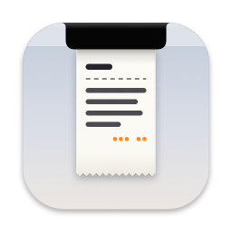
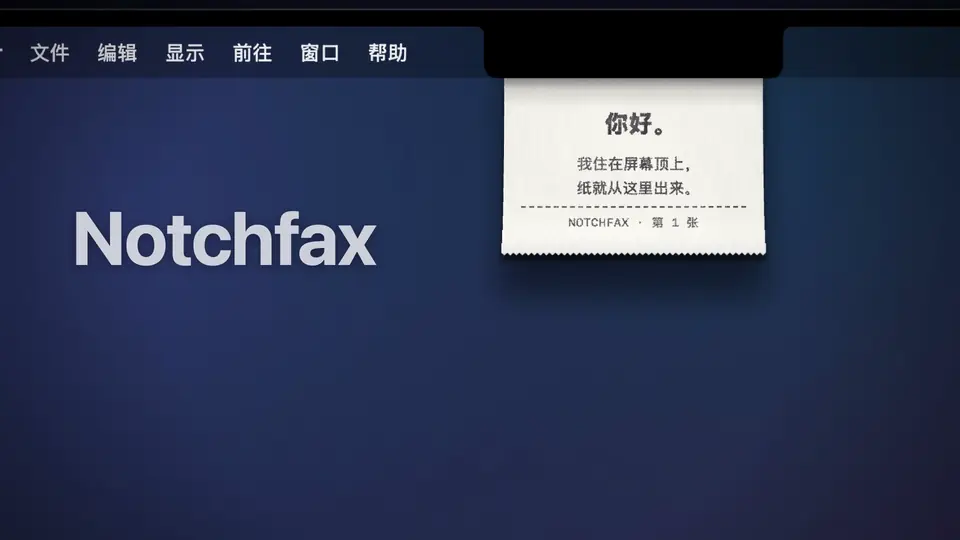
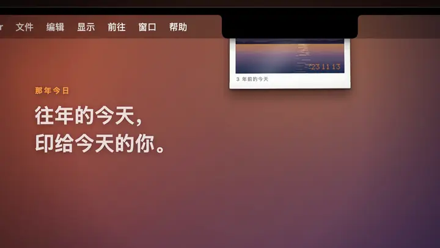
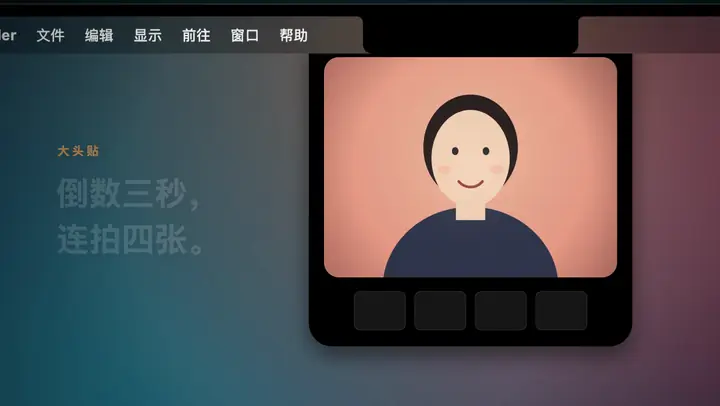
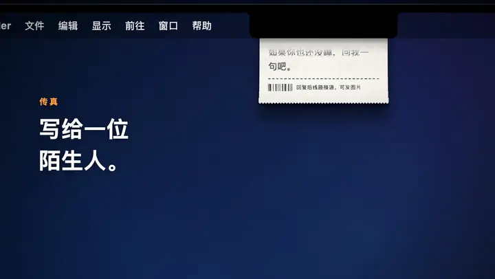
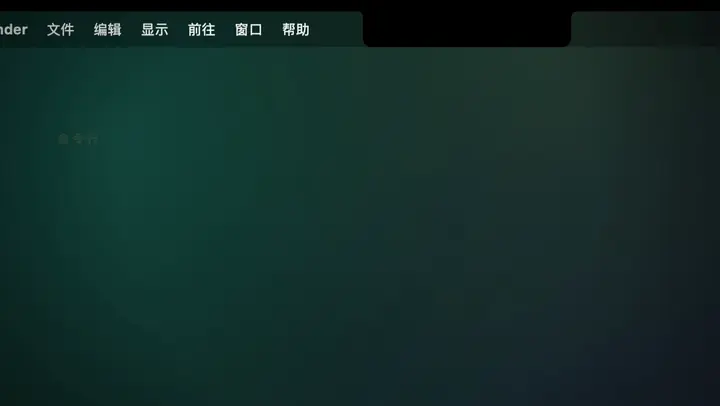

<div align="center">



# Notchfax

**住在刘海里的小打印机**

把 MacBook 的刘海当成出纸口：纸从屏幕顶部正中吐出来，可以抓着晃、横着撕、拖出去存成图片。

[](https://github.com/kadaliao/notchfax/releases/latest)
[](https://github.com/kadaliao/notchfax/actions/workflows/ci.yml)


[](LICENSE)

中文 · [English](README.en.md)



</div>

## 目录

- [它会做什么](#它会做什么)
- [安装](#安装)
- [命令行](#命令行)
- [AI 会话小票](#ai-会话小票)
- [传真与隐私](#传真与隐私)
- [从源码构建](#从源码构建)
- [项目状况](#项目状况)
- [参与](#参与)

## 它会做什么

Notchfax 常驻菜单栏，所有功能都在那个小纸条图标里。

### 那年今日



每天从本机照片图库里找出往年今天拍的照片，印在光面相纸上：右下角是橙色点阵日期，白边上写着「N 年前的今天」。照片只在本机读取，不会上传。

### 大头贴



出纸口下方降下取景框，倒数三秒连拍四张，印成一条。十种滤镜（卡通、漫画、素描、波普、梦幻、拍立得、暖调、冷调、黑白、原色），方向键切换。快捷键 <kbd>⌃</kbd><kbd>⌥</kbd><kbd>⌘</kbd><kbd>B</kbd>。

### 传真



匿名写给一位随机的陌生人。第一封只能是文字；对方回复后线路接通，才能互发图片，图片一律转成黑白点阵。没有账号，没有昵称。

### 命令行和 AI 会话小票



在终端里用 `notchfax print` 让刘海吐纸，也可以让编程助手每结束一次会话就打一张花费小票。

没有刘海的屏幕会在顶部正中画一个出纸口。系统开了「减少动态效果」时，走纸改为淡入淡出。

## 安装

```sh
brew install --cask kadaliao/tap/notchfax
```

或者到 [Releases](https://github.com/kadaliao/notchfax/releases/latest) 下载 dmg，把 Notchfax 拖进「应用程序」。

- 需要 macOS 14 以上，Apple Silicon 和 Intel 通用，已签名并经过 Apple 公证。
- 第一次启动会请求照片图库和摄像头权限，分别用于那年今日和大头贴，然后印一张说明小票。
- 没有自动更新。升级用 `brew upgrade --cask notchfax`，或重新下载。

## 命令行

用 Homebrew 装的已经带了 `notchfax` 命令。下载 dmg 装的，在菜单里点「安装命令行工具…」，会在 `/usr/local/bin` 放一个 `notchfax`（要输一次管理员密码）。它就是 App 自己的可执行文件，所以也可以自己建链接：

```sh
ln -s /Applications/Notchfax.app/Contents/MacOS/Notchfax ~/.local/bin/notchfax
```

```sh
notchfax print 你好                         # 一张热敏小票
echo 你好 | notchfax print                  # 从管道读
notchfax print -i 截图.png "## 今天的截图"  # 图在上、字在下，图会抖成黑白点
notchfax print --photo -i 照片.jpg          # 印在光面相纸上
notchfax help                               # 全部选项
```

Notchfax 没在运行时会在后台把它打开再打印（`--no-launch` 则直接失败）。命令在打印请求排进队列时就返回，不等纸出来。

| 退出码 | 含义 |
|---|---|
| 0 | 成功 |
| 1 | 被 App 拒绝，比如内容太长 |
| 2 | 用法或输入有误 |
| 3 | 连不上 App |

文字支持几个行首标记，用来排小票：

| 写法 | 效果 |
|---|---|
| `# 标题` | 大号粗体，居中 |
| `## 文字` | 粗体 |
| `> 文字` | 小字 |
| `^ 文字` | 居中，可以叠在别的标记前面：`^ > 谢谢惠顾` |
| `---` / `===` | 虚线 / 实线 |
| `左<Tab>右` | 两栏，右栏靠右，适合写价格 |

不想解析标记就加 `--plain`，文字会原样印出来。一张纸最高约 1400 点，印不下会报错，不会截断。

## AI 会话小票

让 Claude Code、Pi、OpenCode 这类编程助手每干完一次活，就从刘海里吐一张小票：用了哪些模型、多少 token、按官方标价算花了多少钱。

最省事的做法：点菜单里的「AI 会话小票…」，拷贝里面的提示词发给你的 AI。它会按自己的钩子或插件机制装好，再打一张样票给你看。面板里的「打一张样票」可以先看看小票长什么样。

各家的钩子和会话记录格式都不一样，也一直在变，所以 Notchfax 不替它们装。[`integrations/`](integrations/) 里放着已经在用的实现，提示词会让 AI 先看这些：

| 助手 | 目录 | 什么时候出票 |
|---|---|---|
| Claude Code | [`claude-code/`](integrations/claude-code/) | `SessionEnd` hook |
| Pi | [`pi/`](integrations/pi/) | 会话关闭（退出、新开、切换、分叉） |
| OpenCode | [`opencode/`](integrations/opencode/) | TUI 退出 |
| DeepSeek Harness 桌面版 | [`dsh/`](integrations/dsh/) | 归档会话、退出 App |

每个目录都写了怎么装、怎么关、怎么手动打一张对账单。给别的助手写，照 [`integrations/README.md`](integrations/README.md) 里的共同做法和统一的小票格式来。欢迎把你的实现提 PR 加进来。

<details>
<summary>Claude Code 手动安装</summary>

[`integrations/claude-code/notchfax-receipt.py`](integrations/claude-code/notchfax-receipt.py) 是一个 SessionEnd hook：会话结束时，按转录里的 token 用量和 API 标价算出这次花了多少钱（分模型列出输入、输出、缓存读写，含子代理）。放到稳定的位置，再加进 `~/.claude/settings.json`：

```json
"hooks": {
  "SessionEnd": [
    {"hooks": [{"type": "command", "command": "/usr/bin/python3 /path/to/notchfax-receipt.py", "timeout": 5}]}
  ]
}
```

默认只给有人在场的会话出小票（终端、桌面 App、IDE），`claude -p` 和 SDK 驱动的自动任务不出。同一个会话再次结束时只结新增的部分。

| 环境变量 | 作用 |
|---|---|
| `NOTCHFAX_RECEIPT_ENTRYPOINTS` | 哪些入口出小票，`*` 为全部 |
| `NOTCHFAX_RECEIPT_MIN_USD` | 低于这个数不打，默认 0.01 |
| `NOTCHFAX_RECEIPT_CNY_RATE` | 顺便折成人民币 |

会话还没结束也能随时打一张到目前为止的对账单（不算结账）；加 `--dry-run` 只在终端里显示：

```sh
python3 integrations/claude-code/notchfax-receipt.py --session <会话 ID>
```

</details>

## 传真与隐私

传真经过一台中继服务器，默认是公共中继 `notchfax.liaoxingyi.com`。也可以把 [`server/`](server/) 部署到自己的 Cloudflare 账号（免费套餐够用），再在菜单「传真服务器…」里换成自己的地址。

- 没有账号、昵称、邮箱。身份是本机生成的一把密钥，存在登录钥匙串里。
- 服务器不记录 IP，也不开请求日志。
- 图片在对方确认收到 24 小时后删除；线路关闭 30 天后清理。
- 照片图库和摄像头画面只在本机处理，只有你主动发出的传真会离开这台 Mac。

协议见 [`docs/protocol.md`](docs/protocol.md)，服务器的设计和限额见 [`server/README.md`](server/README.md)。

## 从源码构建

需要 macOS 14 以上、Xcode（Swift 6）和 [XcodeGen](https://github.com/yonaskolb/XcodeGen)。App 没有第三方依赖。

```sh
xcodegen generate
xcodebuild -scheme Notchfax -configuration Debug -derivedDataPath build/DerivedData build
open build/DerivedData/Build/Products/Debug/Notchfax.app
```

Debug 构建的传真默认连本机的 `http://127.0.0.1:8787`。测试、启动参数、本地跑中继服务器、目录结构和发版流程见 [CONTRIBUTING.md](CONTRIBUTING.md)。

## 项目状况

这是一个人维护的业余项目，按 [语义化版本](https://semver.org/lang/zh-CN/) 发版，每个版本的改动记在 [CHANGELOG.md](CHANGELOG.md)。

它是在一台没有刘海、没有摄像头的 Mac mini 上开发的。下面这些只有代码路径和离屏、脚本验证，没在真机上用过，遇到问题请[提 issue](https://github.com/kadaliao/notchfax/issues/new/choose)：

- **真刘海**：位置和宽度取自 `NSScreen` 的安全区与辅助区域，只用「模拟刘海」检查过画面。
- **真摄像头**：大头贴只跑过模拟画面；真实摄像头、连续互通相机、权限弹窗没有实测。
- **那年今日的自动打印**：手动打印跑过；每天定时那一路依赖时间和在场检测，没有等过真实的一天。
- **多显示器、全屏空间、合盖再开**：有处理代码，没有实测。
- **声音和触感**：声音全部程序合成，波形有单元测试，但没人认真听过；触感需要带力度触控板的机器。
- **「安装命令行工具…」**：要弹管理员密码框，只验证过拼出来的命令。`notchfax` 命令本身和 Claude Code 小票实际跑过；Pi、OpenCode、DSH 的插件在作者机器上用着，仓库里整理过的版本只手动跑过出票脚本。

## 参与

欢迎提 issue 和 PR。动手之前先看 [CONTRIBUTING.md](CONTRIBUTING.md)，较大的改动请先开 issue 聊一下方向。

## 许可

[MIT](LICENSE) © Kada Liao
